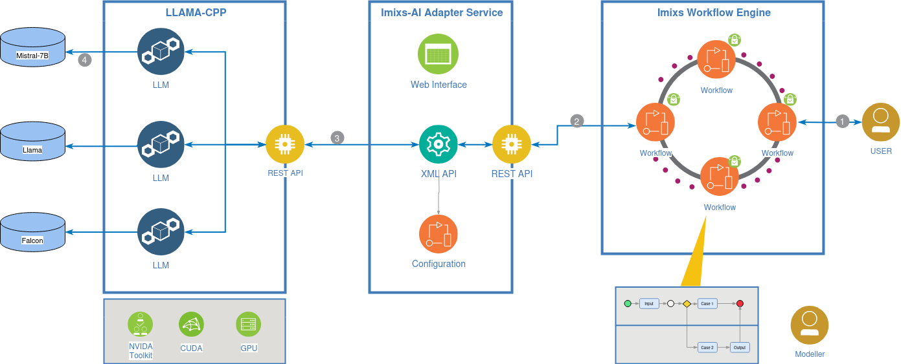
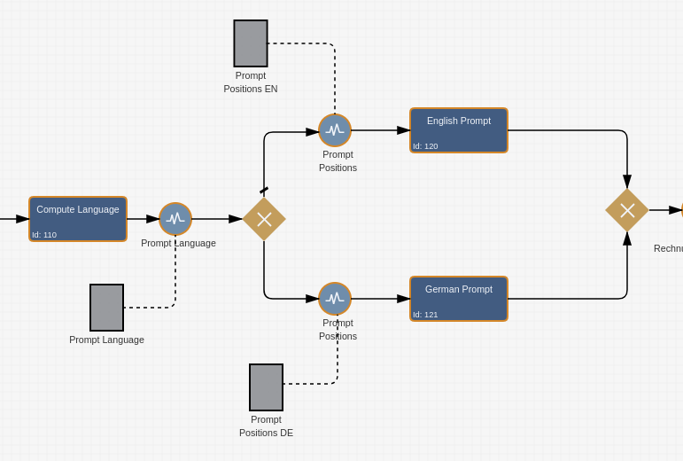

[](https://opensource.org/licenses/EPL-2.0)

# Imixs-AI Project

**Imixs-AI** is an open source project that seamlessly integrates **Large Language Models (LLMs)** into the processing live cycle of the [Imixs-Workflow Engine](https://www.imixs.org).
The project is based on the [Open-AI API](https://github.com/openai/openai-openapi) specification and can be used to access compliant AI Servers like the [LLaMA.cpp HTTP Server](https://github.com/ggerganov/llama.cpp), [Ollama](https://ollama.com/), [vLLM](https://docs.vllm.ai/en/latest/), as also cloud-based AI services.
This gives you the complete freedom to choose your preferred hosting solution and LLM.

The project provides services and adapters to facilitate the interaction of AI into a BPMN 2.0 based workflow. Imixs-AI completely integrates via the BPMN 2.0 standard into the concept of LLMs. This means that no programming skills are required when interacting with a LLM.



## Modules

Imixs-AI is a multi-module project. For building AI-based workflows you only need the module **imixs-ai-workflow**. The modules **imixs-ai-agent** and **imixs-ai-rag** are optional features which can be added if needed. All other modules are used internally.

```
imixs-ai-api  ←  imixs-ai-workflow  ←  imixs-ai-agent  (optional)
                        ↑
                  imixs-ai-rag  (optional)  →  imixs-workflow-index
```

### Imixs-AI-Workflow

The module [imixs-ai-workflow](./imixs-ai-workflow) is the base module for AI-based workflows. It provides Jakarta EE services and adapter classes to access an LLM server.
A prompt can be defined directly in an Imixs BPMN 2.0 model. Prompt templates used by the LLMAdapter class can be defined in a BPMN data object:



### Imixs-AI-Agent (optional)

The module [imixs-ai-agent](./imixs-ai-agent) provides classes for agentic workflow systems.

### Imixs-AI-RAG (optional)

The module [imixs-ai-rag](./imixs-ai-rag) provides Retrieval Augmented Generation (RAG) for business documents. Documents are indexed by BPMN events into the vector index of the [imixs-workflow-index](https://github.com/imixs/imixs-workflow/tree/master/imixs-workflow-index). A retrieval finds similar documents and respects the read access of the current user.

RAG requires:

- the module `imixs-workflow-index` as the index module of the application
- the vector index enabled (`index.vector.enabled=true`, `index.vector.dimension`)
- a central embedding endpoint (`rag.embeddings.endpoint`)

### Internal Modules

These modules are used internally and are not added to an application directly.

- [imixs-ai-api](./imixs-ai-api) - core classes to access an LLM server based on the [Open-AI API](https://github.com/openai/openai-openapi) specification.
- [imixs-ai-bpmn](./imixs-ai-bpmn) - an API to transform BPMN 2.0 models into a text representation understandable by any LLM.

### Imixs-AI-LLaMAcpp

The module [imixs-ai-llama-cpp](./imixs-ai-llama-cpp/README.md) provides a short introduction on how to run a LLaMA.cpp server with Docker.
