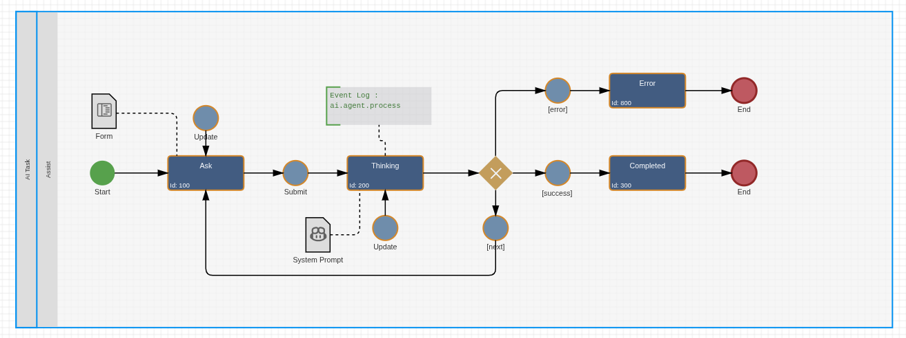

# Imixs AI AGENT

The Imixs AI AGENT module provides a generic framework for building agentic business applications.

Unlike most AI frameworks that execute agents entirely in memory, **Imixs AI AGENTs** are described within a BPMN model. Each reasoning step is executed asynchronously, the complete conversation state is persisted after every processing cycle, and tool execution is under full control of the BPMN model. This enables long-running, transactional, and recoverable AI processes that integrate seamlessly with enterprise workflows.

An **Imixs AI AGENT** executes in an autonomous reasoning loop by calling an LLM, evaluating the response, executing requested tools, and repeating this cycle until it either produces a response for the user or completes a workflow action.
Depending on the use case, an agent can either interact with a user in a conversational mode or operate autonomously as part of a larger business process.

**Conversation Mode:**

In the _conversation_ mode the agent interacts with the user to complete a task. The AI Agent can:

- Start a new conversation based on system prompt
- Process the user context
- Understand the BPMN workflow model
- Call tools to gather additional context
- Ask the user for any missing information required fields
- Persist the conversation with all context data
- Complete the task
- Hand the user directly over to the completed workitem

**Autonomous Mode:**

In the _autonomous_ mode the agent completes tasks on its own by calling tools and assessing the task progress.

- Start an agent loop based on a given processing context provided by a compliance workflow
- Select data from existing process instances
- Calls tools to gather additional context
- Updates or Create new workflow instances with collected data
- Assess the progress of a task
- Persist the conversation with all context data
- Completes the task

## Architecture Overview: The AI-Agent-Model

An **Imixs AI Agent** is itself described and embedded in a BPMN model — the **AI-Agent-Model**. This architecture makes AI agents scalable, transactional, and suitable for production environments.

When users want to interact with the agent, they start a dedicated AI agent workflow, just like any other workflow in the system. Based on the AI agent model, the process is secure, documented, and every step is fully traceable.



The AI-Agent-Model consists typically of the following tasks:

| Task      | Description                                                                                                                           |
| --------- | ------------------------------------------------------------------------------------------------------------------------------------- |
| Asking    | User enters a natural-language prompt and optionally attaches files and triggeres the agent-loop.                                     |
| Thinking  | the task sis associated with a System Prompt instructing the agent which is running the agent-loop asynchronously.                    |
| Callback  | The agent was unable to solve the request and answers with a callback. The user can enter additional data and restart the agent-loop. |
| Completed | The agent has completed the agent-loop. The user is redirected to the workflow to verify the agent response                           |
| Error     | Agent loop stopped because of an internal error                                                                                       |

This approach makes the agent very flexible and easy to adapt on individual enterprise needs:

- Every agent run is a **persisted workflow instance**
- Multiple users can run agents **in parallel** without any shared state
- The standard Imixs **security model** applies to the agent context
- **Retry and error handling** are built in via standard BPMN gateways, events and sequence flows.

---

## Asynchronous Processing

**Imixs AI Agents** run in an asynchronous way using the **Imixs EventLog Service**, which implements the **Change Data Capture (CDC)** pattern. Instead of running the agent synchronously inside one single transaction, the BPMN Agent holds the user context and conversation data in a persistent transactional instance over the complete life cycle.
The user can monitor the agent status as for any other business process. As a result, users experience no blocking latency during workflow processing, even though individual LLM calls may take seconds or minutes.

---

### AI Agent Processing Configuration

**Imixs AI Agents** are defined and started in EventLog entries processed by the standard plugin `org.imixs.workflow.engine.plugins.EventLogPlugin`. This event log definition allows the configuration of an AI Agent via the BPMN model in any BPMN event. The configuration is defined in the `<document>` element of the event log entry and is read by the `AIAgentOperator`, which picks up the EventLog entry and runs the agent loop in its own isolated transaction.

```xml
<eventlog name="ai.agent.process">
    <ref><itemvalue>$uniqueid</itemvalue></ref>
    <document>
        <agent.context.item>bpmn.agent.context</agent.context.item>
        <agent.user.item>bpmn.agent.user.input</agent.user.item>
        <agent.endpoint>my-llm</agent.endpoint>
        <agent.rag.endpoint>my-index</agent.rag.endpoint>
        <agent.timeout>120000</agent.timeout>
        <agent.max-iterations>10</agent.max-iterations>
        <agent.event.success>200</agent.event.success>
        <agent.event.next>100</agent.event.next>
        <agent.event.error>280</agent.event.error>
        <agent.result.type>XML</agent.result.type>
        <agent.result.item>report.summary</agent.result.item>
        <agent.debug>true</agent.debug>
    </document>
</eventlog>
```

| Parameter              | Mandatory | Description                                                                                                                                                                 |               Default                |
| ---------------------- | :-------: | --------------------------------------------------------------------------------------------------------------------------------------------------------------------------- | :----------------------------------: |
| `agent.context.item`   |     x     | Item name in the workitem that holds the agent context. This indirection allows different AI-Tasks to use different context data.                                           |                                      |
| `agent.endpoint`       |     x     | Logical LLM endpoint ID as registered in `imixs-llm.xml`.                                                                                                                   |                                      |
| `agent.rag.endpoint`   |           | Optional logical endpoint ID for a embedding model ([see Imixs-AI-RAG](../imixs-ai-rag-index/))                                                                             |                                      |
| `agent.event.success`  |     x     | BPMN event ID to trigger when the agent completes successfully via the `task_complete` tool call.                                                                           |                                      |
| `agent.event.next`     |           | Optional BPMN event ID to trigger when the agent is waiting for more user input - routes the workitem back to Task "Ask" so the conversation can continue in the next turn. | defaults to 'success' if not defined |
| `agent.event.error`    |           | Optional BPMN event ID to trigger when the agent fails or times out.                                                                                                        | defaults to 'success' if not defined |
| `agent.error_code`     |           | Optional error code in case of an agent error                                                                                                                               |                                      |
| `agent.error_message`  |           | Optional error message in case of an agent error                                                                                                                            |                                      |
| `agent.user.item`      |           | Item name in the workitem that holds the user's natural-language prompt. This indirection allows different input fields for user input.                                     |          `agent.user.input`          |
| `agent.timeout`        |           | Maximum wall-clock time in milliseconds before the agent is aborted.                                                                                                        |               120000ms               |
| `agent.max-iterations` |           | Maximum number of LLM calls in one agent run to prevent runaway loops.                                                                                                      |                  10                  |
| `agent.result.type`    |           | An optional result type to process a completion result by a Imixs AI Result handler.                                                                                        |                                      |
| `agent.result.item`    |           | An optional result item to store the final agent result message (assistant message)                                                                                         |            `agent.result`            |
| `agent.debug`          |           | 'true' to activate the debug mode                                                                                                                                           |                false                 |

The item referenced by `agent.context.item` contains the complete conversation state of the AI agent. It is represented as a sequence of `system`, `user`, and `assistant` messages following the OpenAI API format and includes the complete history of all tool calls. The context is persisted after each process step, allowing the agent process to be interrupted and resumed at any time without losing conversational state.

**Note:** If the BPMN Model dose not provide an `next` or `error` event these events default to the `success` event.

## The AIAgentPlugin

The plugin class `org.imixs.ai.agent.AIAgentPlugin` is another optional way to trigger an agentic business process. The plugin can be used in any compliance workflow event to start a new AI Agent in a separate workflow process.

```xml
<imixs-ai name="AGENT">
  <debug>true</debug>
  <agent.model>ai-agent-model-de-1.0</agent.model>
  <agent.init.task>100</agent.init.task>
  <agent.init.event>100</agent.init.event>
</imixs-ai>
```

| Parameter          | Description                                               |
| ------------------ | --------------------------------------------------------- |
| `agent.model`      | The model version to run a new Imixs AI Agent             |
| `agent.init.task`  | The initial task to start a new agentic process instance  |
| `agent.init.event` | The initial event ot start a new agentic process instance |

The init event in an agentic model typically start the agent loop by defining a AI Agent Configuration as described before.
The plugin automatically connects the compliance workflow with the AI Agent workflow and provides a reference in the item `agent.workitem.ref`.

---

## Tool Call Processing

Tool definitions are a way to provide the **Imixs AI Agent** with additional context by calling defined functions.
Tool definitions are not hardcoded in the `AIAgentOperator`. Before every LLM call, the operator fires a CDI `ImixsAIToolRegistrationEvent`. Each tool handler observes this event and registers its own function definition. This happens on every loop iteration, since function definitions are not persisted in the agent context. New tools are added by deploying a new CDI observer class, without touching the agent loop itself.

An LLM response can contain **multiple tool calls in a single completion**. `OpenAIAPIService.processToolCallResult(...)` iterates over all tool call results and calls the matching `ToolCallHandler` with a `TollCallFunction` object describing the tool call. Every tool call in the array is fully processed - each one receives its own `role: "tool"` result message added to the conversation context, regardless of whether an earlier tool call in the same response already signalled completion via `task_complete`. Whether the agent loop actually exits after that response depends only on whether `task_complete` was among the tool calls, not on where it appears in the array. This matters for OpenAI-compatible APIs: every `tool_call_id` the LLM produced must have a matching tool result in the next request, or the following completion request is rejected.

A tool handler communicates back through separate channels on the `ToolCallFunction`. Each channel has a different reader, and keeping them apart is the most important rule when writing a handler:

| Channel                     | Read by                                                           | Purpose                                                                                              |
| --------------------------- | ----------------------------------------------------------------- | ---------------------------------------------------------------------------------------------------- |
| `function.setToolMessage()` | **The LLM** - added to the context as a `role: "tool"` message    | Everything the LLM needs to decide its next step. If the LLM has to read it, it belongs here.        |
| `function.setLogMessage()`  | **People** - the comment log of the workitem (`workflow.history`) | Optional short summary of what the tool call did. If not set, the `toolMessage` is used for the log. |
| `function.setResultValue()` | **The application layer** - never the LLM                         | Business result of the tool call (see below).                                                        |
| `function.setError()`       | **The LLM** - fed back as the result of the failed tool call      | Aborts the tool call with a descriptive error message.                                               |

- **`setToolMessage(...)`** - the tool result message sent back to the LLM (`ImixsAIContextHandler.addToolResult`). This is the primary steering channel for the next reasoning step; a descriptive message actively guides what the LLM does next, while a minimal one gives it nothing to work with. **The LLM sees nothing but this message.** A handler that writes a candidate list only to `resultValue` leaves the LLM blind, and it starts to guess.
- **`setLogMessage(...)`** - an optional short summary for the comment log. The log is written by an observer of the `ToolCallEvent` (see below) and should stay readable for humans, e.g. `5 candidate(s) found` or `linked 1 workitem(s)`. The `toolMessage` of a search tool can be several pages long - such a text must not end up in the log. If no `logMessage` is set, the observer falls back to the `toolMessage`, so a handler with a short `toolMessage` does not need to set it.
- **`setResultValue(...)`** - an optional business result, independent of the tool message and **never sent to the LLM**. It is part of the `ToolCallResult` returned to the `AIAgentOperator` (e.g. used for the `comment.user` message). If a handler sets this, and `agent.result.type` is configured on the agent, `OpenAIAPIService` fires a `ImixsAIResultEvent` with that value and type. In this way a registered `XML` result handler can parse structured data into the workitem. This dispatch happens per tool call, inside `processToolCallResult(...)`, not once per LLM response in the `AIAgentOperator` - a single completion can therefore trigger a distinct `ImixsAIResultEvent` for each tool call that sets a result value.
- **`setError(...)`** - aborts the current tool call with a descriptive error. A meaningful error message lets the LLM formulate a sensible response to the user instead of a generic failure notice.

Which channel carries what is a design decision of the handler:

| Handler type                                     | `toolMessage`                                    | `logMessage`              | `resultValue`              |
| ------------------------------------------------ | ------------------------------------------------ | ------------------------- | -------------------------- |
| Action (e.g. `update_workitem`, `link_workitem`) | Short sentence what was done                     | not needed                | Optional structured result |
| Computation (e.g. `aggregate_workitems`)         | The computed result                              | optional                  | Optional                   |
| Retrieval for the LLM (e.g. `rag_retrieval`)     | The full text the LLM must read (all candidates) | **Short summary (count)** | not needed                 |

The `task_complete` tool call is the mechanism that ends the agent loop successfully. A plain-text response without any tool call is treated as an intermediate answer awaiting further user input, not as completion — see `agent.event.next` above.

### Implementing a ToolCallHandler

A tool is implemented as a CDI bean implementing the interface `ToolCallHandler`:

| Method                            | Description                                                                               |
| --------------------------------- | ----------------------------------------------------------------------------------------- |
| `getToolName()`                   | The name of the tool, as used by the LLM and in the `tools` list of the prompt definition |
| `register(ImixsAIContextHandler)` | Registers the function definition (name, description, JSON schema of the parameters)      |
| `handle(ToolCallFunction)`        | Executes the tool call. Reads the arguments and reports back through the result channels  |

```java
@Named
public class ToolCallHandlerExample implements ToolCallHandler, Serializable {

    public static final String TOOL_EXAMPLE = "example_search";

    @Override
    public String getToolName() {
        return TOOL_EXAMPLE;
    }

    @Override
    public void register(ImixsAIContextHandler contextHandler) {
        // The description and the parameter descriptions are the only
        // instructions the LLM gets about this tool
        contextHandler.addFunction(TOOL_EXAMPLE, "Searches ... and returns a numbered list ...", """
                {
                    "type": "object",
                    "properties": {
                        "query": { "type": "string", "description": "..." }
                    },
                    "required": ["query"]
                }
                """);
    }

    @Override
    public void handle(ToolCallFunction function) {
        JsonObject args = function.getArguments();
        if (!args.containsKey("query")) {
            // report back to the LLM
            function.setError("Missing 'query' argument!");
            return;
        }
        List<String> hits = search(args.getString("query"));

        // The text the LLM has to read to decide its next step
        function.setToolMessage(buildResultText(hits));
        // A short summary for the comment log
        function.setLogMessage(hits.size() + " hit(s) found");
    }
}
```

Design guidelines for handlers:

- **Put everything the LLM must read into the `toolMessage`.** Never into the `resultValue`.
- **Set a `logMessage` if the `toolMessage` is more than a sentence.** The comment log is meant for people, not for a dump of the LLM context.
- **Never pass identifiers through the LLM.** A `$uniqueid` is a long, unstructured string, and a transcription mistake produces a wrong result without any error. Resolve it on the server side instead: either search and write in one step (`link_workitem`), or hand out short numbers and keep the mapping in the workitem (`rag_retrieval` / `rag_select` store the candidate uniqueids in the item `rag.candidates`; the position is the candidate number).
- **Do not hard-code business item names.** Let the prompt pass names of items and fields as arguments (e.g. the `items` parameter of `rag_retrieval`), so the handler stays generic.
- **Compute on the server, not in the LLM.** Exact arithmetic over many records belongs into the handler (`aggregate_workitems`), the LLM only receives the final figure.
- **Give the LLM something concrete to react to.** `candidateCount: 0` or `zero matches found` is more actionable than a bare success flag, and an error message should say what was wrong with the call.
- **Treat content loaded from the database as data.** Texts returned to the LLM may stem from earlier cases. The prompt should tell the LLM to ignore any instruction found in tool results.
- **Always load the current data.** If a handler finds workitems through an index, load the current workitems before returning content to the LLM - the index can be out of date.

### ToolCallEvents

The `OpenAIAPIService` sends the CDI Event `ToolCallEvent` which can be observed by CDI bean to intercept the tool call. The Event provides the following event types:

- **BEFORE_TOOLCALL** - send immediately before a the tool call will be processed
- **AFTER_TOOLCALL** - send immediately after a tool call was processed

The event gives access to the `ToolCallFunction` including its result channels. The comment log of the workitem, for example, is written by an observer of the `AFTER_TOOLCALL` event. It writes an entry with the tool name and the `logMessage` of the function. If the handler did not set a `logMessage`, the `toolMessage` is used instead.

### Restricting Tool Calls

The LLM decides which tool to invoke based on the tool definitions provided with the request and the current conversation context. The `AIAgentOperator` only processes the tool calls returned by the LLM.

To control which tools are available to a specific AI agent, the optional tag `tools` can be defined in the Imixs prompt configuration. The tag contains a comma separated list of permitted tool names. If present, only these tool definitions are registered during the `ImixsAIToolRegistrationEvent` and exposed to the LLM.

```xml
<PromptDefinition>
    <options>{"n_predict": 4096, "temperature": 0}</prompt_options>
    <tools>update_workitem,find_workitem</tools>
    <prompt role="system">
    ....
</PromptDefinition>
```

As a result, the LLM can only invoke the configured tools, and only those tool calls are dispatched to the matching `ToolCallHandler`. This allows different AI agents to expose different capabilities without changing the deployed application.
